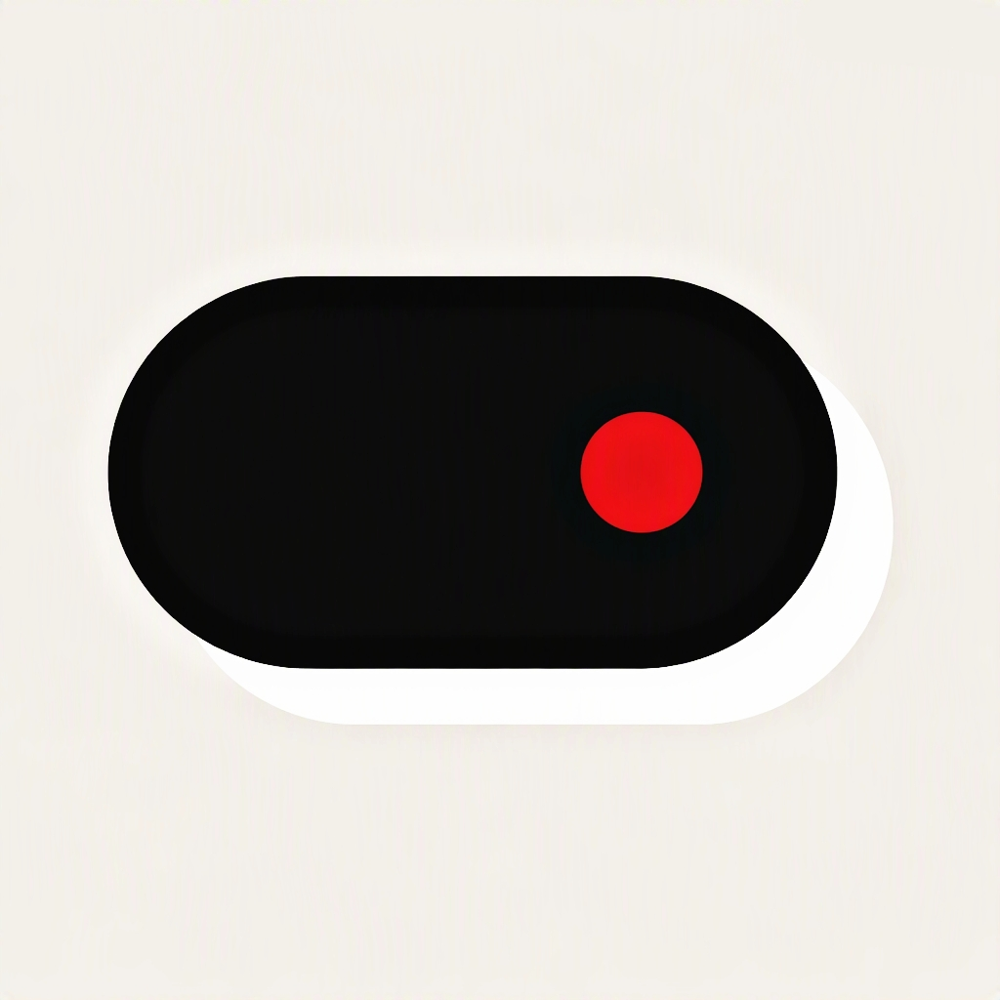

# (NOT) ISLAND // (01)
### Authentic Nothing OS 3.0 Dynamic Island for Android

<p align="center">
  
</p>

<p align="center">
  <b>AESTHETIC: NOTHING OS 3.0 BRUTALIST</b> &bull; <b>EQUALIZER: DOT-MATRIX RED</b> &bull; <b>TARGET: ANDROID 8.0 - 15+</b>
</p>

<p align="center">
  <a href="https://github.com/d4rxh/Nothing-Island/releases"></a>
  
  
  
</p>

---

## 🔴 Overview

**(NOT) ISLAND** is a bespoke, system-wide dynamic floating overlay engineered specifically around the front camera punch-hole of **Nothing Phone (1)**, **Nothing Phone (2)**, **Nothing Phone (2a)**, and all modern Android devices.

Unlike generic iOS Dynamic Island clones, **(NOT) ISLAND** embraces the iconic **Nothing OS 3.0 brutalist industrial aesthetic** — featuring authentic **NDot57 dot-matrix typography**, responsive red LED equalizers, OLED pitch-black containers, full geometry customization, and micro-haptic tactile responses.

---

## ⚡ Core Features

```
┌────────────────────────────────────────────────────────┐
│  [🎵 ART]  ● [FRONT CAMERA PUNCH-HOLE]  [||| RED DOTS] │
└────────────────────────────────────────────────────────┘
                    ▲ (COMPACT ISLAND)
                    │ (Tap / Long-Press)
                    ▼
┌────────────────────────────────────────────────────────┐
│  NOTHING MEDIA // SPOTIFY                          ━   │
│  ┌─────┐  Starboy                                      │
│  │ ART │  The Weeknd                      [|||| EQUAL] │
│  └─────┘                                               │
│             [⏮️]        [ ⏸️ ]        [⏭️]              │
└────────────────────────────────────────────────────────┘
```

### 1. 🎵 Live Music Equalizer & Controller
- Automatically detects playback across **Spotify, YouTube Music, Apple Music, Telegram, Soundcloud, and local players**.
- **Compact Island Mode:** Left shows circular spinning album art; right features a real-time dancing 4-column **Nothing Red Dot-Matrix Equalizer (`DotMatrixEqualizerView`)**.
- **Expanded Card Mode:** Tap to expand into a full Nothing OS 3.0 control card with marquee track title, artist name, and tactile playback buttons (`Previous`, `Play/Pause`, `Next`).

### 2. ⚡ Fast Charging Dynamic Alert
- Connecting your charger instantly triggers a smooth capsule expansion.
- Displays an animated crimson lightning bolt glyph alongside real-time battery percentage in authentic **NDot57** dot-matrix typography.

### 3. 💬 Smart Heads-Up Notifications
- Floating non-intrusive pill for **WhatsApp, Telegram, SMS, and incoming calls**.
- Briefly expands with the sender name and message preview without interrupting full-screen games or video playback.
- Automatically collapses smoothly after 4.5 seconds.

### 4. 🎛️ Complete Size, Geometry & Position Customizer
- **Horizontal (X) Offset:** Move anywhere from -120 dp (left hole) to +120 dp (right hole).
- **Vertical (Y) Position:** Precise top margin adjustment (0 dp to 60 dp).
- **Island Width:** Customize compact pill width from 70 dp to 220 dp.
- **Island Height:** Fine-tune pill height from 28 dp to 50 dp.
- **Corner Radius:** Adjust curvature from 8 dp (squircle) to 26 dp (full pill).
- **Camera Cutout Diameter:** Match your exact punch-hole camera diameter.
- **Hardware Presets:** Instant 1-tap alignment for **Nothing Phone (1)** and **Nothing Phone (2 / 2a)**.

### 5. 🛡️ 100% Zero-Leak Privacy Guarantee
- **ZERO INTERNET PERMISSION:** The app does NOT declare `android.permission.INTERNET` in its manifest. The Android OS kernel strictly forbids the app from making any network connection.
- **ZERO TRACKERS / ZERO ADS:** No analytics SDKs, no cloud tracking, no accounts.
- **EPHEMERAL LOCAL STORAGE:** Media titles and notification text exist solely in volatile device memory while displayed and are discarded immediately.

---

## 📦 Direct Download

Download the signed release APK directly from GitHub Releases:

👉 **[Download Nothing-Island-v1.0.8.apk](https://github.com/d4rxh/Nothing-Island/releases/download/v1.0.8/Nothing-Island-v1.0.8.apk)**

---

## 🛠️ Tech Stack & Architecture

- **Language:** Kotlin 2.0+ (100%)
- **Target SDK:** 35 (Android 15) &bull; **Min SDK:** 26 (Android 8.0 Oreo)
- **Overlay Engine:** `WindowManager.LayoutParams.TYPE_APPLICATION_OVERLAY` with `LAYOUT_IN_DISPLAY_CUTOUT_MODE_SHORT_EDGES`
- **Typography:** Authentic `NDot57` dot-matrix font assets
- **Foreground Service:** Crash-resilient foreground service architecture with safe Android 14/15 fallbacks
- **CI/CD:** Automated GitHub Actions pipeline with Keystore V1/V2 release signing

---

## 📄 License
Licensed under the [MIT License](LICENSE).
